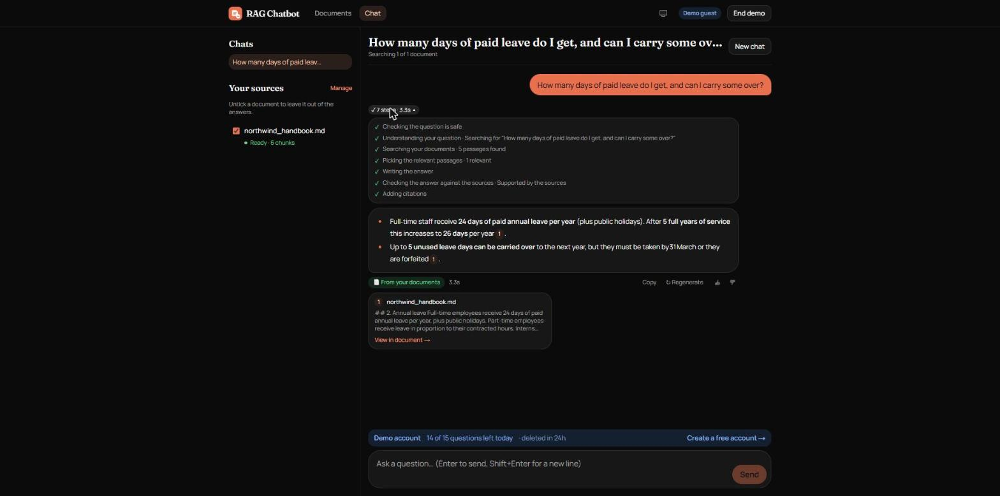
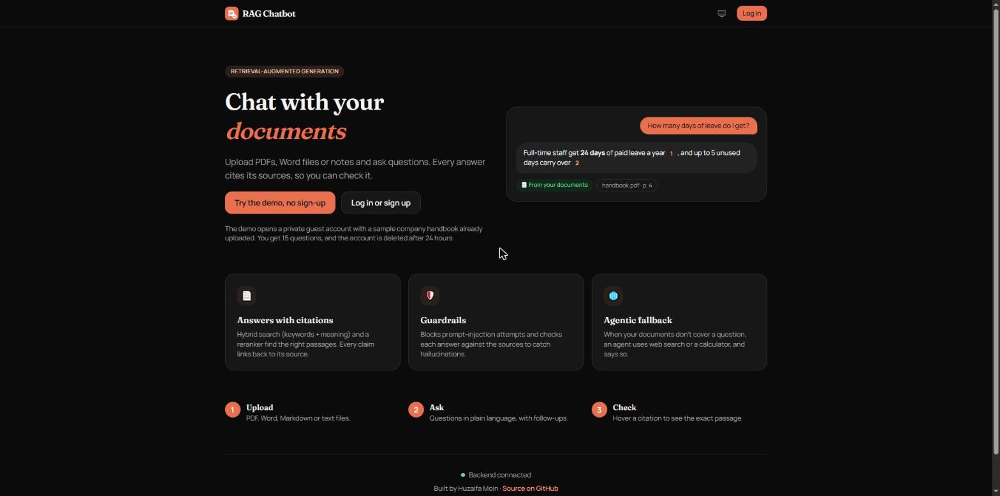
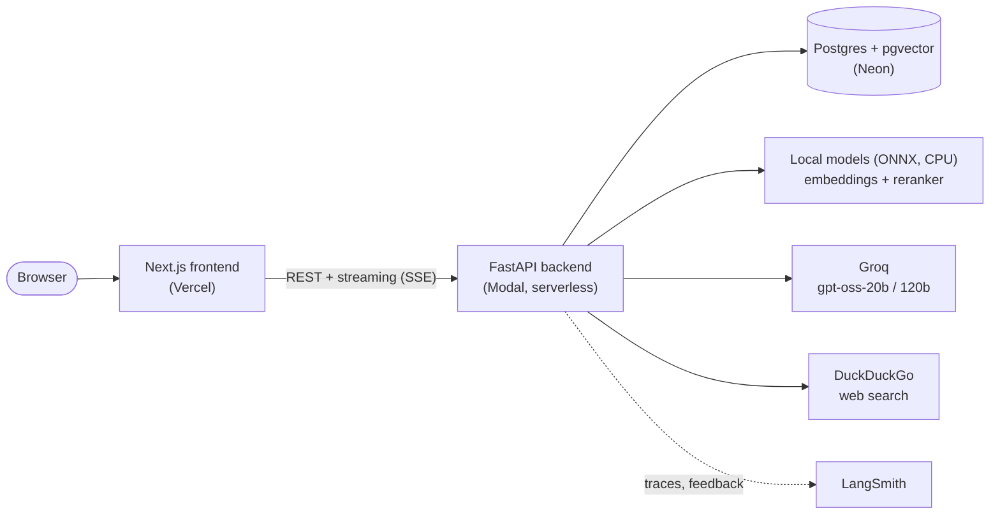
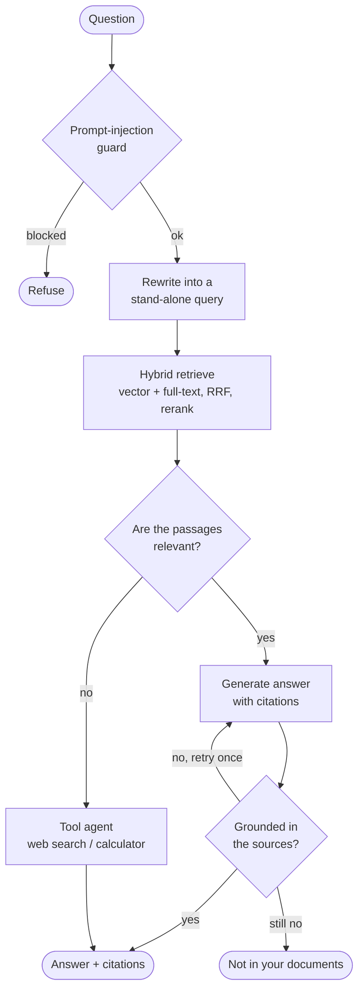

# RAG Chatbot

**Chat with your documents. Every answer cites its sources.**

Upload PDFs, Word files or notes, ask questions in plain language, and get answers grounded in your files, with numbered citations you can hover to see the exact passage. When your documents don't cover a question, an agent falls back to web search or a calculator and says so.

**[▶ Try the live demo](https://rag-chatbot-six-psi.vercel.app)** (no sign-up: a guest account with a sample company handbook is created for you)

[](https://github.com/HuzaifaMoin/rag-chatbot/actions/workflows/ci.yml)
[](https://github.com/HuzaifaMoin/rag-chatbot/actions/workflows/evals.yml)
[](https://github.com/HuzaifaMoin/rag-chatbot/actions/workflows/deploy-backend.yml)

> The backend sleeps when nobody is using it, so the first request after a quiet period takes ~15 seconds to wake it up. After that, answers take a few seconds.



<details>
<summary>Home page</summary>



</details>

---

## Features

- **Answers with citations**: hybrid search (keywords + meaning) and a reranker find the right passages, and every claim links back to its source document and page.
- **Agentic fallback**: when the documents don't have the answer, a tool-using agent searches the web (DuckDuckGo) or uses a calculator, and the answer is labelled with where it came from.
- **Guardrails**: prompt-injection attempts are blocked, and each answer is checked against its sources; ungrounded answers are regenerated or replaced with "not in your documents".
- **Live agent steps**: answers stream in token by token, with each step of the agent shown as it runs.
- **Documents**: upload PDF, Word, Markdown and text files, see processing status, read a document's text, and choose which documents an answer may use.
- **Saved chats**: conversation history with rename and delete, follow-up questions, regenerate, copy.
- **Accounts and a demo mode**: email/password login (JWT), plus throwaway guest accounts that expire after 24 hours, with rate limits.
- **Feedback and observability**: 👍/👎 on every answer is linked to its LangSmith trace; a LangSmith dashboard tracks volume, latency, tokens, feedback and errors.

## Architecture



### How a question is answered (LangGraph)



**Retrieval** combines two searches in Postgres, pgvector cosine similarity and full-text search, merges them with Reciprocal Rank Fusion, then reorders the top candidates with a cross-encoder reranker. Embeddings (`bge-small-en-v1.5`) and the reranker (MiniLM, 8-bit quantized) run locally on CPU through ONNX, so search costs nothing per query.

## Tech stack

| Area | Tools |
|---|---|
| Frontend | Next.js 16 (App Router), React 19, TypeScript, Tailwind CSS v4 |
| Backend | Python 3.12, FastAPI, SQLAlchemy (async) + asyncpg, Pydantic |
| AI | LangGraph, LangChain, Groq (open-weight LLMs), fastembed (ONNX), Llama Prompt Guard |
| Data | PostgreSQL + pgvector (Neon in production, Docker locally) |
| Quality | pytest, Playwright, ruff, ESLint, LangSmith evals with an LLM judge |
| Ops | Docker, GitHub Actions, Modal, Vercel, LangSmith tracing and dashboards, uv |

## Engineering quality

- **Tests**: 136 backend tests (unit + API integration against a real Postgres) and a Playwright end-to-end test of the full user journey.
- **CI** on every push: lint, type-check and build the frontend; ruff + pytest for the backend; build and start the production Docker image; the Playwright test.
- **Evals**: a 16-question dataset over a fictional company handbook, scored in LangSmith on correctness (LLM judge), choosing the right source, citing sources, and not hallucinating. It runs weekly and on demand, with a quality gate that fails the run if correctness drops below 80%. Latest run: 100% on all four checks.
- **Continuous deployment**: the backend deploys to Modal only after CI passes on `main`; Vercel builds the frontend on every push.
- **Production safety**: the server refuses to start in production with a weak JWT secret or a missing API key; demo accounts are rate-limited per IP and per day.

## Running for $0

The whole project runs on free tiers with no credit card: Vercel (frontend), Modal (backend), Neon (database), Groq (LLM), LangSmith (tracing). Search models run locally instead of through a paid embeddings API.

Fitting the backend into small free servers took some work. Under a 512 MB memory limit, the first version crashed while processing a 50 KB upload. Profiling showed the ONNX models keeping their peak memory forever, and processing text in large batches. The fix was smaller batches, turning off ONNX's memory arena, and switching to an 8-bit quantized reranker (63 MB instead of 157 MB in memory, with identical rankings on the eval set). Now a 2 MB upload peaks at about 430 MB, and the evals still score 100%.

## Run it locally

You need [Docker](https://www.docker.com/), [uv](https://docs.astral.sh/uv/) and Node.js 22+, plus free API keys from [Groq](https://console.groq.com/keys) and (optionally) [LangSmith](https://smith.langchain.com).

```bash
git clone https://github.com/HuzaifaMoin/rag-chatbot.git
cd rag-chatbot
cp .env.example .env          # then fill in GROQ_API_KEY (and LangSmith if you want traces)

docker compose up -d --wait   # Postgres + pgvector

cd backend
uv sync
uv run uvicorn app.main:app --port 8000      # API docs at http://localhost:8000/docs

# in a second terminal
cd frontend
npm install
npm run dev                                  # http://localhost:3000
```

Tests:

```bash
cd backend && uv run pytest         # needs the Docker Postgres running
cd frontend && npm run e2e          # Playwright end-to-end test
cd backend && uv run python -m evals.run_evals   # LangSmith evals (uses your Groq quota)
```

## Project structure

```
backend/
  app/
    agent/          LangGraph graph, guardrails, tools, LLM setup
    routers/        API endpoints: auth, documents, search, chat, conversations, feedback
    retrieval.py    hybrid search + reciprocal rank fusion + reranking
    ingestion.py    extract text, chunk, embed, store
    embeddings.py   local ONNX embedding + reranker models
    demo.py         guest accounts with the preloaded handbook
  evals/            eval dataset, evaluators, runner with a quality gate
  tests/            pytest suite
  Dockerfile        production image (models baked in)
  modal_app.py      deployment on Modal
frontend/
  src/app/          pages: home, login, chat, documents
  src/components/   chat messages, citations, navigation...
  e2e/              Playwright test
.github/workflows/  CI, evals, backend deploy
```

## Limitations

- The free backend sleeps when idle, so the first request after a while is slow.
- Groq's free tier limits tokens per minute; under heavy use, answers can be rate-limited.
- Uploads are limited to 20 MB (2 MB for demo accounts), and scanned PDFs without a text layer aren't supported (no OCR).

---

Built by **Huzaifa Moin**.
